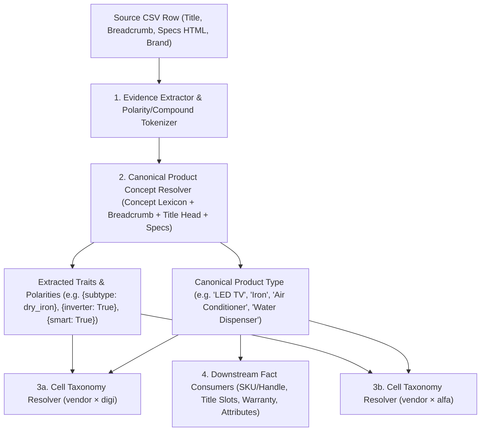
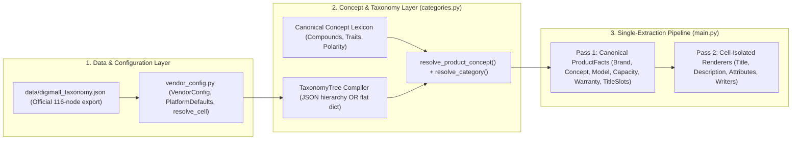

# Pre-Phase-2 Foundation Audit, Architecture Design & Implementation Plan

**Project:** `Dynamic_CSV_Generator` (`kiachahiye_bulk_csv`)  
**Branch:** `the-new-way` (HEAD `c9616b7`)  
**Document Role:** Single Authoritative Master Plan for Pre-Phase-2 Foundation Stabilization (Milestone M1.5)  
**Mode:** Architectural Audit & Implementation Specification (Zero Production Code Modified)

---

## 1. Executive Summary and Primary Goal

### 1.1 Primary Mission
Our objective is to stabilize the foundational architecture of `kiachahiye_bulk_csv` before entering **Phase 2 (Description AST & Cell-Aware Rendering)** so that the system operates as a **genuinely dynamic, configurable, DRY, deterministic, and strictly isolated multi-vendor × multi-platform CSV engine**.

Specifically, we must eliminate the need to modify core Python control flow (`if/elif` product branches, global stop-lists, or manual flattened category paths) whenever:
1. A new vendor is onboarded or an existing vendor's category coverage expands.
2. A marketplace provides a raw hierarchical category taxonomy (e.g., DigiMall JSON export, future Shopify/Daraz/WordPress trees).
3. A taxonomy uses **atomic leaves** on one platform (`11767 Dry Iron`, `11766 Steam Iron`, `11750 Garment Steamer` on Ajmer × DigiMall) and **combined/multi-concept leaves** on another (`11515 Iron & Garment Steamer` on Ajmer × Alfa, or `11669 Water Dispensers & Purifiers` on DigiMall).
4. A source CSV contains noisy, umbrella, or brand-bucket breadcrumbs (`Electronics > Home appliances > Iron & Garment steamer` or `LED TV / Smart LED TV / TCL LED`) or missing category cells.

### 1.2 Why Stabilization Is Required Before Phase 2
Phase 0 and Phase 1 (M1.1–M1.4) successfully introduced `VendorConfig`, `PlatformConfig`, `ResolvedCellConfig`, cell-scoped series vocabularies, and two-stage Title extraction/rendering (`extract_title_slots` -> `render_title_and_seo_from_slots`). However, our forensic audit of the current `the-new-way` working tree revealed five critical foundational gaps that would compromise Phase 2 if left unresolved:

1. **Uncommitted Product-Specific Hardcoding in Working Tree:** Recent uncommitted edits in [categories.py](file:///d:/Dynamic_CSV_Generator/kiachahiye_bulk_csv/categories.py#L336-L365) and [vendor_config.py](file:///d:/Dynamic_CSV_Generator/kiachahiye_bulk_csv/vendor_config.py#L448-L595) introduced hardcoded `elif digi_key in ("irons", ...)` and `_GROUP_LED` branches, unsafe fallback guessing (defaulting any iron without a subtype keyword to `steam iron`), and a 145-line manually flattened category/alias dictionary on `AJMER`.
2. **Configuration Boundary Violations (`resolve_cell` Bypass & Truthiness Fallback):** [categories.py](file:///d:/Dynamic_CSV_Generator/kiachahiye_bulk_csv/categories.py#L302-L317) and [brands.py](file:///d:/Dynamic_CSV_Generator/kiachahiye_bulk_csv/brands.py#L167-L192) bypass `resolve_cell(vendor_cfg, platform)` and read `vendor_cfg.digi` / `vendor_cfg.alfa` directly. Worse, [vendor_config.py](file:///d:/Dynamic_CSV_Generator/kiachahiye_bulk_csv/vendor_config.py#L204-L210) and [categories.py](file:///d:/Dynamic_CSV_Generator/kiachahiye_bulk_csv/categories.py#L308-L317) use truthiness (`or` / `if vendor_cfg.digi_segment_aliases`), causing an explicit `{}` on a vendor or cell to silently inherit global KCC defaults.
3. **Combined vs. Atomic Category Semantics Gap:** The current matcher (`_match_table_key` in [categories.py](file:///d:/Dynamic_CSV_Generator/kiachahiye_bulk_csv/categories.py#L221-L242)) uses dict-order substring checks and lacks a model for **combined destination categories** (`"iron & garment steamer": "11515"`, `"Water Dispensers & Purifiers": "11669"`) versus **umbrella source breadcrumbs** (`"Electronics > Home appliances > Iron & Garment steamer"`).
4. **Product Type Coupled to Marketplace Category Lookups:** `resolve_product_type()` in [categories.py](file:///d:/Dynamic_CSV_Generator/kiachahiye_bulk_csv/categories.py#L420-L467) derives canonical `Product Type` from `category.matched_key` (a marketplace category table key). When a vendor × platform cell lacks a category ID for a product (or has an empty category table), `Product Type` degrades to naive breadcrumb tail stripping (`_infer_product_type`), corrupting downstream `sku_handle`, `title_builder`, `warranty`, and `attributes`.
5. **Pipeline Extraction Order & Redundant Execution:** [main.py](file:///d:/Dynamic_CSV_Generator/kiachahiye_bulk_csv/main.py#L246-L520) runs brand/category/product-type resolution three times per row (in `read_rows`, Pass 1, and Pass 2), runs heavy HTML/spec/title/description/attribute extraction twice per row, passes a **rendered title** (`attribute_title`) into `build_attributes()` instead of canonical facts + source text, and validates SEO title length only against DigiMall's rendered SEO title.

---

## 2. Verified Current State and Skills Applied

### 2.1 Engineering Skills Applied
In accordance with [using-agent-skills](file:///d:/Dynamic_CSV_Generator/.agents/skills/using-agent-skills/SKILL.md), the following repository skills and project rules were loaded and applied to govern this audit and design:
- **Project Rules:** [dry_dynamic_algorithm.md](file:///d:/Dynamic_CSV_Generator/.agents/rules/dry_dynamic_algorithm.md) (Zero hardcoding of product rules; strict vendor × platform isolation) and [pricing_engine.md](file:///d:/Dynamic_CSV_Generator/.agents/rules/pricing_engine.md).
- **[doubt-driven-development](file:///d:/Dynamic_CSV_Generator/.agents/skills/doubt-driven-development/SKILL.md):** Applied adversarial self-review to challenge both the existing codebase and our own earlier *Principal Architecture Review: Category Resolution Engine*, catching the combined-category (`11515` / `11669`) flaw before a single line of code was written.
- **[code-simplification](file:///d:/Dynamic_CSV_Generator/.agents/skills/code-simplification/SKILL.md):** Rejected overengineered multi-tier weighted scoring frameworks and NLP dependencies in favor of a deterministic 4-stage concept-set and taxonomy-tree resolver.
- **[spec-driven-development](file:///d:/Dynamic_CSV_Generator/.agents/skills/spec-driven-development/SKILL.md) & [api-and-interface-design](file:///d:/Dynamic_CSV_Generator/.agents/skills/api-and-interface-design/SKILL.md):** Specified exact frozen dataclasses, function signatures, and enum contracts before implementation.
- **[python-pro](file:///d:/Dynamic_CSV_Generator/.agents/skills/python-pro/SKILL.md), [tdd](file:///d:/Dynamic_CSV_Generator/.agents/skills/tdd/SKILL.md), [planning-and-task-breakdown](file:///d:/Dynamic_CSV_Generator/.agents/skills/planning-and-task-breakdown/SKILL.md), & [documentation-and-adrs](file:///d:/Dynamic_CSV_Generator/.agents/skills/documentation-and-adrs/SKILL.md):** Structured dependency-ordered milestones, formal ADRs, and a 25-scenario adversarial test matrix.

### 2.2 Verified Git & Working Tree State on `the-new-way`
- **Branch:** `the-new-way`
- **Recent Commits:**
  - `c9616b7` — `feat(title_builder): support include_color and exclude color from DigiMall titles`
  - `9f96eb2` — `feat(title_builder): filter inverter words from display model in audit and title for DigiMall`
  - `5c8ce4f` — `fix: extract numeric models from labels and unambiguous titles`
  - `b20f013` — `feat: include nested input CSVs in the file menu`
  - `4b16f7b` — `docs: explain launcher workflow and Phase 0/1 under The New Way`
  - `8c2c13c` — `feat: implement Phase 1 cell configuration and title rendering`
- **Dirty Working Tree Files (Uncommitted):**
  - `M kiachahiye_bulk_csv/categories.py` (+38 lines: adds `_GROUP_LED` and `elif digi_key in ("irons", ...)` hardcoded branches)
  - `M kiachahiye_bulk_csv/vendor_config.py` (+145 lines: adds manually flattened `AJMER.digi.categories` and `digi_segment_aliases`)

> [!IMPORTANT]
> **What Phase 0 & Phase 1 Already Fixed (Do Not Rebuild):**
> Older planning files ([tasks/implementation_plan (3).md](file:///d:/Dynamic_CSV_Generator/tasks/implementation_plan%20(3).md) and [tasks/todo.md](file:///d:/Dynamic_CSV_Generator/tasks/todo.md)) were written *prior* to commit `8c2c13c`. Our forensic code inspection confirms that the following items are **already implemented and tested** in HEAD:
> - `ResolvedCellConfig` with `Cell > Vendor > Platform > Engine` `_inherit()` precedence ([vendor_config.py](file:///d:/Dynamic_CSV_Generator/kiachahiye_bulk_csv/vendor_config.py#L108-L216)).
> - `omit_title_color_categories`, `include_color`, and `include_inverter_in_title` wired into [title_builder.py](file:///d:/Dynamic_CSV_Generator/kiachahiye_bulk_csv/title_builder.py#L2519-L2640) and [main.py](file:///d:/Dynamic_CSV_Generator/kiachahiye_bulk_csv/main.py#L381-L396).
> - `apply_tv_warranty_table` wired into [warranty.py](file:///d:/Dynamic_CSV_Generator/kiachahiye_bulk_csv/warranty.py#L123-L141) and [audit.py](file:///d:/Dynamic_CSV_Generator/kiachahiye_bulk_csv/audit.py#L638-L806).
> - Cell-scoped series corpus discovery via `_vendor_vocabularies(vendor_cfg)` ([series_corpus.py](file:///d:/Dynamic_CSV_Generator/kiachahiye_bulk_csv/series_corpus.py#L212-L247)).
> - Cell-scoped HTML template extraction via `template_for_cell(vendor_cfg, platform).extract()` in [audit.py](file:///d:/Dynamic_CSV_Generator/kiachahiye_bulk_csv/audit.py#L468) and [thin_report.py](file:///d:/Dynamic_CSV_Generator/kiachahiye_bulk_csv/thin_report.py#L137).

---

## 3. Master Plan Gap and Root-Cause Matrix

Every discrepancy across the codebase, uncommitted working tree, earlier reviews, and planning docs is classified below using the seven mandatory forensic statuses:
- **Confirmed defect** — Broken or violating core invariants in current HEAD or working tree.
- **Architectural limitation** — Works for legacy KCC cases but fails to scale dynamically across vendors/taxonomies.
- **Potential risk** — Latent edge case that can cause silent misbehavior under new inputs.
- **Already fixed** — Listed in older task docs (`implementation_plan (3).md`), already resolved in Phase 1 (`8c2c13c`–`c9616b7`).
- **Legitimate platform/domain constraint** — Official marketplace schema/allowed-value rule that *should* remain authoritative data.
- **Intentionally deferred work** — Scoped to Phase 2+ in `PLAN.md`.
- **No action needed** — Verified clean and compliant.

| ID | Subsystem / Location | Classification | Root Cause & Actual Runtime Behavior | Downstream Impact |
|---|---|---|---|---|
| **G-01** | [categories.py](file:///d:/Dynamic_CSV_Generator/kiachahiye_bulk_csv/categories.py#L326-L365) (`resolve_category`, `_GROUP_AC`, `_GROUP_LED`, uncommitted `irons` branch) | **Confirmed defect** | Hardcodes product-specific subtype splits in Python `if/elif` chains. Uncommitted lines 345 & 358–363 silently default any unspecified Iron to `steam iron` and guess across `basic tv`/`smart tv` when evidence is absent. | Violates zero-hardcoding rule and no-silent-guessing rule; assigns wrong DigiMall leaf IDs (`11766` instead of flagging missing subtype). |
| **G-02** | [vendor_config.py](file:///d:/Dynamic_CSV_Generator/kiachahiye_bulk_csv/vendor_config.py#L448-L595) (uncommitted `AJMER` edits) | **Confirmed defect** | Manually flattens 70+ DigiMall category paths and 45+ ad-hoc `digi_segment_aliases` (`"iron": "irons"`, `"dry iron": "dry iron"`) into Python code instead of ingesting raw taxonomy JSON. | Impossible to maintain for SaaS/new vendors; mixes parent nodes (`"irons": "11639_11643_11748"`) with leaf nodes. |
| **G-03** | [vendor_config.py](file:///d:/Dynamic_CSV_Generator/kiachahiye_bulk_csv/vendor_config.py#L204-L210) & [categories.py](file:///d:/Dynamic_CSV_Generator/kiachahiye_bulk_csv/categories.py#L302-L317) (`resolve_cell`, `resolve_category`, `resolve_product_type`) | **Confirmed defect** | `resolve_cell()` uses `or` truthiness on `category_segment_aliases` (`cell_raw.category_segment_aliases or ...`) and `product_type_map`. `categories.py` bypasses `resolve_cell()` completely and checks `if vendor_cfg.digi_segment_aliases else DIGI_SEGMENT_ALIASES`. | An explicit empty dict `{}` on a vendor or cell falls back to KCC's global `DIGI_SEGMENT_ALIASES`, `ALFA_SEGMENT_ALIASES`, and `PRODUCT_TYPE_MAP`, violating strict vendor isolation. |
| **G-04** | [categories.py](file:///d:/Dynamic_CSV_Generator/kiachahiye_bulk_csv/categories.py#L135-L142) (`STOP_SEGMENTS` vs `AJMER.digi.categories["ups"]`) | **Confirmed defect** | `STOP_SEGMENTS` globally blocks `"ups"`, `"sound bars"`, `"speakers"`, `"audio & visuals"`, and `"green energy"` at line 264 *before* checking the cell's category table. | Any vendor that legitimately sells UPS (`11671`), Sound Bars (`11695`), or Speakers (`11693`) has its breadcrumb segment silently discarded as a stop-word! |
| **G-05** | [categories.py](file:///d:/Dynamic_CSV_Generator/kiachahiye_bulk_csv/categories.py#L221-L242) (`_match_table_key`) | **Architectural limitation** | Matches breadcrumb segments against dictionary keys using dict-iteration order and bidirectional substring matching (`_word_in(key, segment)` and `_word_in(segment, key)`). | Short/head nouns (`"oven"`, `"iron"`, `"heater"`, `"ac"`, `"freezer"`) can falsely match compound products (`"microwave oven"`, `"water heater"`, `"water dispenser with freezer"`). |
| **G-06** | Earlier Architecture Review §C/§D vs. [vendor_config.py](file:///d:/Dynamic_CSV_Generator/kiachahiye_bulk_csv/vendor_config.py#L628) (`"iron & garment steamer": "11515"`) & `digimall_raw.json` (`11669`) | **Architectural limitation** | Earlier review treated `"Iron & Garment Steamer"` solely as a source umbrella breadcrumb. In reality, destination taxonomies also contain **combined assignable leaf nodes** (`11515 Iron & Garment Steamer` in Alfa; `11669 Water Dispensers & Purifiers`, `11861 Cooktops & Ranges`, `11804 Juicer & Fruit Extractors` in DigiMall). | A single-concept product (`Dry Iron` or `Water Dispenser`) MUST resolve to a combined destination leaf when no narrower child leaf exists in that platform's taxonomy, whereas a combined *source breadcrumb* (`Iron & Garment Steamer`) must NOT resolve to an atomic `Garment Steamer` leaf when the title says `Dry Iron`. |
| **G-07** | [categories.py](file:///d:/Dynamic_CSV_Generator/kiachahiye_bulk_csv/categories.py#L420-L467) (`resolve_product_type`) | **Architectural limitation** | Couples `Product Type` derivation to `category.matched_key` (a marketplace category table lookup). If both platforms lack a category entry for a product (or a vendor starts with `{}`), it falls back to `_infer_product_type()`, which strips the last breadcrumb segment. | Causes false `CAT_PRODUCT_TYPE_INFERRED` flags on known appliances (`Deep Freezer`, `Air Fryer`) and produces broken `Product Type` values (e.g. `"LED"` instead of `"LED TV"` when the final breadcrumb segment is `"TCL LED"`), breaking downstream `sku_handle`, `warranty`, `title_builder`, and `attributes`. |
| **G-08** | [brands.py](file:///d:/Dynamic_CSV_Generator/kiachahiye_bulk_csv/brands.py#L167-L192) (`resolve_brand`) | **Confirmed defect** | Reads `vendor_cfg.digi.brands` and `vendor_cfg.alfa.brands` directly instead of calling `resolve_cell(vendor_cfg, "digi").brands` and `resolve_cell(vendor_cfg, "alfa").brands`. | Bypasses the Phase 1 `ResolvedCellConfig` boundary. |
| **G-09** | [main.py](file:///d:/Dynamic_CSV_Generator/kiachahiye_bulk_csv/main.py#L325) (`"inverter/non-inverter signal" in digi_reason`) | **Confirmed defect** | Uses a hardcoded English substring check on `category.digi_reason` to decide whether to emit `CAT_AC_SIGNAL_MISSING` vs `CAT_UNMAPPED_DIGI`. | Breaks for any non-AC sibling ambiguity (e.g. `Smart TV` vs `Basic TV`, `Dry Iron` vs `Steam Iron`) or if reason wording changes. |
| **G-10** | [main.py](file:///d:/Dynamic_CSV_Generator/kiachahiye_bulk_csv/main.py#L246-L520) (`read_rows`, `resolve_row` Pass 1 & Pass 2) | **Architectural limitation** | `resolve_brand`, `resolve_category`, and `resolve_product_type` run 3x per row (`read_rows`, Pass 1, Pass 2). HTML parsing, `extract_model`, `resolve_capacity`, `extract_title_slots`, `resolve_warranty`, `build_description_bundle`, and `build_attributes` run 2x per row (Pass 1 only needs `sku` and `handle` for collision counting!). | Doubles/triples CPU work unnecessarily and tangles canonical fact extraction with final cell rendering. |
| **G-11** | [main.py](file:///d:/Dynamic_CSV_Generator/kiachahiye_bulk_csv/main.py#L507-L520) (`attribute_title` passed to `build_attributes`) | **Confirmed defect** | Constructs `attribute_title` from rendered `title_result_alfa.title` or `title_result_digi.title + extract_inverter(text)` and passes that into `build_attributes()`. | Violates the Phase 1 invariant that cell outputs must be rendered from canonical product facts/source evidence, never by feeding one platform's rendered Title into another subsystem. |
| **G-12** | [main.py](file:///d:/Dynamic_CSV_Generator/kiachahiye_bulk_csv/main.py#L462-L492) (`description.seo_title` and `SEO_TITLE_OUT_OF_RANGE`) | **Potential risk** | Calls `build_description_bundle()` once with `title_result_digi.seo_base_title` and `seo_title_digi`, and checks `SEO_TITLE_MIN <= len(description.seo_title) <= SEO_TITLE_MAX` only on `digi`. | If `alfa` and `digi` produce different SEO title lengths (e.g. due to `include_color` or `include_inverter_in_title`), Alfa's SEO title range isn't validated independently. |
| **G-13** | [attributes.py](file:///d:/Dynamic_CSV_Generator/kiachahiye_bulk_csv/attributes.py#L31-L347) (`ALLOWED`, `ALIASES`, `SCOPE`) | **Legitimate platform/domain constraint** (with minor config ownership cleanup) | `ALLOWED`, `ALIASES`, and `SCOPE` encode DigiMall's official closed-vocabulary marketplace schema (`Option Name 1..6`). Exact numeric matching (`9.5 KG` never rounded to `10 KG`) and negation-first ordering (`non-inverter` before `inverter`) are essential correctness rules. | Keep strict closed-list semantics intact; expose attribute schema ownership on `PlatformDefaults` / `ResolvedCellConfig` (`enable_structured_attributes: bool`) and feed source `row.title` + `row.description` + canonical `product_type`. |
| **G-14** | [vendor_config.py](file:///d:/Dynamic_CSV_Generator/kiachahiye_bulk_csv/vendor_config.py#L108-L216), [warranty.py](file:///d:/Dynamic_CSV_Generator/kiachahiye_bulk_csv/warranty.py#L123-L141), [series_corpus.py](file:///d:/Dynamic_CSV_Generator/kiachahiye_bulk_csv/series_corpus.py#L212-L247), [audit.py](file:///d:/Dynamic_CSV_Generator/kiachahiye_bulk_csv/audit.py#L468) | **Already fixed** | Listed as open in legacy `tasks/implementation_plan (3).md`, but already completed and verified by unit tests in Phase 1 (`8c2c13c`–`c9616b7`). | No rebuild needed; preserve existing tests in `tests/test_vendor_config.py`. |
| **G-15** | [description_builder.py](file:///d:/Dynamic_CSV_Generator/kiachahiye_bulk_csv/description_builder.py#L1-L1656) (Full AST split & cell-scoped HTML/plain-text rendering) | **Intentionally deferred work** | Scheduled for Phase 2 (M2.1–M2.4) in `PLAN.md`. | Do not prematurely rewrite `description_builder.py` in M1.5; only ensure M1.5 provides clean canonical facts (`ProductFacts`) and per-cell SEO titles for Phase 2 to consume. |
| **G-16** | [pricing.py](file:///d:/Dynamic_CSV_Generator/kiachahiye_bulk_csv/pricing.py#L1-L130) & [writers.py](file:///d:/Dynamic_CSV_Generator/kiachahiye_bulk_csv/writers.py#L1-L248) | **No action needed** | Clean, deterministic, and adheres to [pricing_engine.md](file:///d:/Dynamic_CSV_Generator/.agents/rules/pricing_engine.md) and platform column contracts. | Preserve as-is. |

---

## 4. Product Understanding and Extraction Dependency Analysis

### 4.1 Why `Product Type` Must Be Decoupled from Marketplace Category Keys
In the current codebase ([categories.py](file:///d:/Dynamic_CSV_Generator/kiachahiye_bulk_csv/categories.py#L420-L467)), `resolve_product_type()` works backward from `category.matched_key` (or reverse-maps `category.alfa_id` / `category.digi_path`) against `PRODUCT_TYPE_MAP`.

This design has a fatal flaw: **what a product *is* (`Product Type`, e.g., `"Refrigerator"`, `"Deep Freezer"`, `"LED TV"`, `"Iron"`, `"Air Conditioner"`) is an intrinsic, canonical product fact—not a side effect of whether a vendor has configured a marketplace Category ID for that product.**

Consider what happens today when a product's category is unmapped on a platform (or when a new vendor is initialized with `categories={}`):
1. `category.matched_key` is `None`.
2. `resolve_product_type()` falls back to `_infer_product_type(category, source_brand)` ([categories.py](file:///d:/Dynamic_CSV_Generator/kiachahiye_bulk_csv/categories.py#L408-L418)), which grabs the last segment of the source breadcrumb, strips the brand name, and strips trailing `"s"`.
3. If the source breadcrumb is `"LED TV / Smart LED TV / TCL LED"`, stripping `"TCL"` yields `Product Type = "LED"` (with `product_type_inferred = True` and a `CAT_PRODUCT_TYPE_INFERRED` QC flag), instead of `"LED TV"`.
4. Downstream modules depend heavily on canonical `Product Type`:
   - [sku_handle.py](file:///d:/Dynamic_CSV_Generator/kiachahiye_bulk_csv/sku_handle.py#L42-L55): `CAPACITY_UNITS` and `CATEGORY_SHORT` key off `product_type.lower()`. `"LED"` instead of `"LED TV"` loses `"Inches"` unit normalization!
   - [title_builder.py](file:///d:/Dynamic_CSV_Generator/kiachahiye_bulk_csv/title_builder.py#L170-L245): `SUBTYPES`, `INVERTER_CONCEPT_CATEGORIES`, and `omit_title_color_categories` key off `product_type.lower()`.
   - [warranty.py](file:///d:/Dynamic_CSV_Generator/kiachahiye_bulk_csv/warranty.py#L60-L141): `WARRANTY_TERMS` and `apply_tv_warranty_table` key off `product_type.lower()`.
   - [attributes.py](file:///d:/Dynamic_CSV_Generator/kiachahiye_bulk_csv/attributes.py#L315-L347): `SCOPE` filters allowed attributes strictly by `product_type.lower()`.

### 4.2 Unified Product Concept & Canonical `Product Type` Architecture
We introduce a unified **Product Concept Recognition** stage that runs *before* marketplace category tree resolution and serves both `resolve_product_type()` and `resolve_category()`:



#### How Canonical `Product Type` Resolution Works:
1. **Authoritative Evidence Precedence:**
   - **Title Primary Head Noun & Spec Product Type:** Extracted using Longest-Phrase-First compound matching and the **Prepositional Secondary-Feature Guard** (so `"Water Dispenser with Refrigerator Compartment"` has primary concept `water_dispenser` -> `Product Type = "Water Dispenser"`, and secondary modifier `refrigerator`, never misclassifying the appliance as a `"Refrigerator"`).
   - **Source Breadcrumb Segments:** Filtered through brand stripping (stripping vendor/source brand prefixes like `"TCL LED"` -> `"LED"` -> concept `television` -> `"LED TV"`) and campaign/organizational noise tokens (`"azadi sale"`, `"ramzan offer"`, `"new arrivals"`).
   - **Cell `product_type_map` Override:** Checked via `resolve_cell(vendor_cfg, platform).product_type_map` (using explicit `None` inheritance, never truthiness `or`).
2. **Independence from Marketplace Category Coverage:**
   - Even if `vendor × digi` and `vendor × alfa` both have `categories = {}` (or lack a leaf for `"Deep Freezer"`), a product titled `"Dawlance DD-300 Deep Freezer 10 Cu.Ft"` with breadcrumb `"Appliances > Deep Freezers"` resolves deterministically to `concept_id = "deep_freezer"` -> `Product Type = "Deep Freezer"` with `product_type_inferred = False`!
   - `product_type_inferred = True` (`CAT_PRODUCT_TYPE_INFERRED`) is reserved strictly for genuinely unknown product verticals that match neither the canonical Concept Lexicon nor the cell's `product_type_map`.

### 4.3 Canonical Pipeline Dependency Order & Pass Consolidation (`main.py`)
In [main.py](file:///d:/Dynamic_CSV_Generator/kiachahiye_bulk_csv/main.py#L230-L530), we eliminate triple brand/category resolution and double HTML/title/description/attribute extraction by structuring the pipeline around **immutable canonical row extraction (Pass 1)** followed by **lightweight handle-collision finalization and cell rendering (Pass 2)**:

1. **`read_rows()` ([main.py](file:///d:/Dynamic_CSV_Generator/kiachahiye_bulk_csv/main.py#L230-L270)):**
   - Reads raw CSV rows and performs lightweight brand/concept extraction once for `discover_vendor_series()` corpus discovery.
2. **Pass 1 — Canonical Fact Extraction (Once per Row):**
   - Resolve `cell_digi = resolve_cell(vendor_cfg, "digi")` and `cell_alfa = resolve_cell(vendor_cfg, "alfa")`.
   - Extract `BrandResolution` via `resolve_brand(row.brand, row.title, row.description, vendor_cfg=vendor_cfg)`.
   - Extract `ProductConcept` (canonical `product_type`, primary concept ID, positive/negative traits, secondary features) from `row.category`, `row.title`, and `row.description` (using cell template extraction).
   - Resolve `ResolvedCategory` for `cell_digi` and `cell_alfa` using `ProductConcept` + cell taxonomy.
   - Extract canonical `ModelResolution`, `CapacityResolution`, `WarrantyResolution`, and `TitleSlots` once.
   - Compute base `sku` and base `handle` (registering `sku` and `handle` in `sku_counts` / `handle_counts`).
3. **Pass 2 — Finalization & Cell-Isolated Rendering (Once per Row):**
   - Apply collision suffixes (`-1`, `-2`) to `sku` and `handle` if `sku_counts` / `handle_counts > 1`.
   - Render `title_result_digi` (`render_title_and_seo_from_slots(slots, cell_digi)`) and `title_result_alfa` (`render_title_and_seo_from_slots(slots, cell_alfa)`).
   - Build `description` bundle and validate `SEO_TITLE_OUT_OF_RANGE` across active platform SEO titles.
   - Build DigiMall structured `AttributesBundle` using **source `row.title` + `row.description` + canonical `product_type`** (eliminating the `attribute_title` hack at [main.py](file:///d:/Dynamic_CSV_Generator/kiachahiye_bulk_csv/main.py#L507-L517)).

---

## 5. Universal Category Semantics and Taxonomy Architecture

### 5.1 Reconciling Our Earlier Category Review: What Changes and Why
In our critical self-review of the earlier *Principal Architecture Review: Category Resolution Engine*, we identified a subtle but critical real-world distinction in marketplace taxonomies:

| Scenario | Earlier Review's Assumption | Real-World Repository Truth (`vendor_config.py` & `digimall_raw.json`) | Required Engine Behavior |
|---|---|---|---|
| **Combined Destination Leaf** (`"iron & garment steamer": "11515"` in Alfa; `"Water Dispensers & Purifiers": "11669"` in DigiMall) | Treated `"Iron & Garment Steamer"` only as an ambiguous umbrella source breadcrumb. | In `AJMER.alfa.categories`, `"11515"` (`iron & garment steamer`) is the **only** assignable leaf for both Irons and Garment Steamers! In DigiMall (`digimall_raw.json`), `"11669"` (`Water Dispensers & Purifiers`) is the single assignable leaf covering both Water Dispensers and Water Purifiers, and `"11804"` (`Juicer & Fruit Extractors`) covers both Juicers and Fruit Extractors. | When a **destination assignable leaf** is a multi-concept/combined node $C = \{c_1, c_2\}$, any product with primary concept $c_p \in C$ **validly matches that leaf**, unless the destination taxonomy has a more specific active leaf $L' \subset C$ with $c_p \in L'$. |
| **Combined Source Breadcrumb** (`"Electronics > Home appliances > Iron & Garment steamer"`) vs **Atomic Destination Leaves** (`11767 Dry Iron`, `11766 Steam Iron`, `11750 Garment Steamer`) | Token overlap on `"Garment Steamer"` could cause a Dry Iron under breadcrumb `"Iron & Garment steamer"` to falsely match `"11750 Garment Steamer"` if `"Garment Steamer"` has more tokens than `"Iron"`. | Ajmer's source CSV uses `"Electronics > Home appliances > Iron & Garment steamer"` as a shared vendor folder for Dry Irons, Steam Irons, and Garment Steamers. Meanwhile, DigiMall has separate leaves: `11750 Garment Steamer` (depth 3), `11766 Steam Iron` (depth 4), `11767 Dry Iron` (depth 4). | A multi-concept **source breadcrumb** (`{iron, garment_steamer}`) only constrains the candidate domain to the union `{iron, garment_steamer}`. The product's **Title & Specs** determine which concept in that union is the actual appliance (`Dry Iron` -> `iron` + `dry`, never `garment_steamer`). |
| **Umbrella Product With Unresolved Atomic Child Split** (Title: `"Philips Iron HD1172"`, Breadcrumb: `"Iron & Garment Steamer"`, Specs: no `dry` or `steam` keyword) | Uncommitted Flash code ([categories.py:345](file:///d:/Dynamic_CSV_Generator/kiachahiye_bulk_csv/categories.py#L345)) silently defaulted to `steam iron` (`11766`). | On **Alfa**, `"11515"` (`iron & garment steamer`) is an assignable leaf covering all irons, so it resolves cleanly to `"11515"`. On **DigiMall**, `11748` (`Irons & Garment Steamers`) is a parent node with active children `11766 Steam Iron` and `11767 Dry Iron`. | Resolve **Alfa -> `"11515"`** (valid combined leaf!). Resolve **DigiMall -> `""` (blank)** with structured `CategoryStatus.SIBLING_AMBIGUOUS` (`CAT_SIBLING_AMBIGUOUS`), listing candidates `11767 Dry Iron` and `11766 Steam Iron`. **Never guess!** |

### 5.2 Formal Taxonomy Graph Model (`TaxonomyTree` & `TaxonomyNode`)
Every cell's category configuration is compiled once (cached on `ResolvedCellConfig`) into an immutable `TaxonomyTree`:

```python
class NodeStatus(str, Enum):
    ASSIGNABLE_LEAF = "assignable_leaf"      # Active leaf node (valid destination ID)
    STRUCTURAL_PARENT = "structural_parent"  # Has active children; cannot be assigned directly
    DEPLETED_BRANCH = "depleted_branch"      # Active parent whose children are ALL inactive (e.g. 11679, 11689)
    INACTIVE_NODE = "inactive_node"          # is_active=False (e.g. 11677 Stand Mixers)

@dataclass(frozen=True)
class TaxonomyNode:
    category_id: str                         # e.g. "11767" or "11515"
    name: str                                # e.g. "Dry Iron" or "iron & garment steamer"
    parent_id: str | None                    # e.g. "11748" or None for flat tables
    handle: str                              # e.g. "electronics/appliances/.../dry-iron"
    is_active: bool                          # True/False from raw taxonomy
    ancestors: tuple[str, ...]               # ("11639", "11643", "11748", "11767")
    formatted_id: str                        # Rendered per cell id_format ("11639_11643_11748_11767" or "11515")
    status: NodeStatus                       # Computed from tree topology & is_active
    concepts: frozenset[str]                 # Canonical concepts covered by this node, e.g. {"iron"} or {"iron", "garment_steamer"}
    required_traits: frozenset[str]          # Distinguishing subtype traits required by this leaf, e.g. {"subtype:dry"} or {"inverter:true"}
    excluded_traits: frozenset[str]          # Explicitly excluded traits, e.g. {"inverter:false"}
```

#### Validated Hierarchy Rules (Verified Against `digimall_raw.json`):
1. **Parent ID Normalization:** Raw JSON mixes `parent: null`, integer `parent: 11639`, and string `"category_id": "11639"`. The loader normalizes all IDs to stripped strings (`str(val).strip()`) and ignores broken `level: 0` values by computing true depth from the parent chain.
2. **Cycle & Orphan Detection:** Validates that every non-null `parent_id` exists and no ancestor chain contains a cycle.
3. **Node Status Classification:**
   - Out of 116 nodes in `digimall_raw.json`:
     - **64 Active Assignable Leaves** (`NodeStatus.ASSIGNABLE_LEAF`)
     - **30 Active Structural Parents** (`NodeStatus.STRUCTURAL_PARENT`)
     - **2 Depleted Branches** (`NodeStatus.DEPLETED_BRANCH`): `11679` (`Large Cooking Appliances`, whose only children `11742 Range Hoods` and `11861 Cooktops & Ranges` are `is_active: false`) and `11689` (`Printers & Scanners`, whose only children `11690`–`11692` are `is_active: false`).
     - **20 Inactive Leaves** (`NodeStatus.INACTIVE_NODE`, e.g., `11677 Stand Mixers`, `11805 Hand Blenders`, `11861 Cooktops & Ranges`).
   - **Strict Assignment Policy:** Only `NodeStatus.ASSIGNABLE_LEAF` may ever be emitted as a CSV category ID. If a product matches an `INACTIVE_NODE` or `DEPLETED_BRANCH`, the resolver returns `""` with `CategoryStatus.INACTIVE_TARGET` (`CAT_INACTIVE_TARGET`) and names the inactive node ID/name in the QC reason—never falling back to a sibling leaf (`11676 Hand Mixers` for a Stand Mixer) or emitting a non-leaf parent ID (`11679`).

### 5.3 Four-Stage Deterministic Concept & Taxonomy Resolution Algorithm

Instead of fragile dictionary-order substring checks or opaque floating-point token weights, category resolution executes four deterministic stages:

#### Stage 1: Phrase-First Evidence & Polarity Extraction
Extracts a `ProductConcept` from source `row.category` (breadcrumb), `row.title`, and `row.description` (spec table + bullet text):
1. **Longest-Phrase-First Compound Recognition:**
   - Scans text against multi-word domain compounds *before* single-word nouns.
   - Once `"microwave oven"` (tokens `[microwave, oven]`) is matched as `concept: microwave_oven`, the token `oven` is consumed and **cannot** match `concept: oven_toaster` (`11666 Ovens & Toasters`).
   - Similarly: `"water heater"` -> `concept: water_heater` (consuming `heater`, never matching `Room Heaters`); `"air cooler"` -> `concept: air_cooler`; `"deep freezer"` -> `concept: deep_freezer`; `"garment steamer"` -> `concept: garment_steamer`; `"washing machine"` -> `concept: washing_machine`; `"air fryer"` -> `concept: air_fryer`.
2. **Prepositional Secondary-Feature Guard:**
   - Splits product titles at secondary-feature boundary markers: `\b(?:with|featuring|including|plus|w/|having)\b`.
   - Tokens *before* the boundary define the **Primary Appliance Concept** (`"Homage Water Dispenser HWD-49332 with Refrigerator Compartment"` -> primary: `water_dispenser`, secondary modifier: `refrigerator_compartment`).
   - Secondary modifiers never override the primary appliance concept.
3. **Bound Polarity & Subtype Trait Extraction:**
   - Negated forms are matched first and bound as atomic negative traits:
     - `\b(?:non|without)[-\s]*inverter\b` or `\bfixed\s+speed\b` -> `trait = "inverter:false"` (consumes `inverter` so positive `inverter` cannot fire).
     - `\b(?:twin\s*tub|semi[-\s]*automatic)\b` -> `trait = "wash_mode:semi_auto"` (consumes `automatic`).
     - `\b(?:non[-\s]*smart|basic\s+(?:tv|led)|standard\s+led)\b` -> `trait = "tv_type:basic"`.
     - `\bdry\s+iron\b` -> `trait = "iron_type:dry"`.
     - `\bsteam\s+iron\b` -> `trait = "iron_type:steam"` (whereas `"steam generator"` on a Garment Steamer stays bound to `concept: garment_steamer` because primary concept takes precedence over subtype).
4. **Evidence Authority Hierarchy (Handling Contradictions):**
   - **Title Primary Concept + Structured Spec Table** > **Source Breadcrumb Leaf** > **Source Breadcrumb Ancestors** > **Unstructured Description Prose**.
   - *Why:* If a vendor places a `"Philips Dry Iron HD1172"` inside an umbrella breadcrumb `"Electronics > Home appliances > Iron & Garment steamer"`, the breadcrumb contributes candidate concepts `{iron, garment_steamer}`, while the Title Primary Concept (`Dry Iron`) selects `iron` (`trait: iron_type:dry`). Conversely, if a description paragraph contains marketing fluff like *"pairs well with your refrigerator and microwave oven"*, prose mentions never override the Title + Breadcrumb primary concept.

#### Stage 2: Candidate Leaf Retrieval (Atomic & Combined Node Matching)
Given the product's primary concept $c_p$ and extracted traits $T$:
1. Check cell-scoped `category_segment_aliases` (if explicitly configured on the cell) and direct concept matches in the cell's `TaxonomyTree`.
2. Collect all nodes $N \in \text{TaxonomyTree}$ where $c_p \in N.\text{concepts}$.
3. **Specificity Filtering (Combined vs. Atomic Leaves):**
   - If the tree contains both a combined/parent node $N_{\text{combined}}$ (`concepts = {iron, garment_steamer}`) and narrower child/sibling nodes $N_{\text{atomic}}$ (`concepts = {iron}`), prefer nodes whose concept set is most specific to $c_p$ ($|N.\text{concepts}| = 1$) **unless** $N_{\text{combined}}$ is itself an `ASSIGNABLE_LEAF` and no narrower active leaf exists for $c_p$ (as in Alfa's `"11515": "iron & garment steamer"` or DigiMall's `"11669": "Water Dispensers & Purifiers"`).

#### Stage 3: Trait Partition & Sibling Disambiguation
When Stage 2 yields multiple sibling leaves sharing the same primary concept $c_p$ (e.g., `11663 Inverter Split AC` vs `11664 Traditional Split AC`; `11686 Basic TV` vs `11687 Smart TV` vs `11688 QLED TV`; `11766 Steam Iron` vs `11767 Dry Iron`; `11675 Fully Automatic` vs `11674 Semi Automatic`):
1. Filter candidates by checking compatibility with extracted product traits $T$:
   - Discard any candidate leaf $L$ where $L.\text{excluded\_traits} \cap T \neq \emptyset$.
   - Select candidate leaf $L$ where $L.\text{required\_traits} \subseteq T$.
2. **Subsumptive Hierarchy Rule for Overlapping Tech Tiers (`QLED TV` vs `Smart TV`):**
   - A QLED TV (`"TCL 55C645 55 Inch QLED 4K Google Smart TV"`) has both `tv_display:qled` and `tv_type:smart`.
   - In DigiMall's taxonomy under `11648 Television`, `11688 QLED TV` (`required_traits = {"tv_display:qled"}`) is strictly more specific than `11687 Smart TV` (`required_traits = {"tv_type:smart"}`) because all QLED TVs are Smart TVs, whereas not all Smart TVs are QLED.
   - Each trait carries a deterministic specificity rank (`tv_display:qled` rank 2 > `tv_type:smart` rank 1). The candidate matching the highest-specificity trait (`11688 QLED TV`) wins deterministically.
3. **No Silent Guessing on Missing Partition Traits:**
   - If multiple active sibling leaves remain tied because the product lacks any distinguishing trait in Title, Breadcrumb, or Specs (e.g., an AC with neither inverter nor non-inverter signal, an Iron with neither dry nor steam signal, or a TV with neither smart nor basic signal):
   - Return `""` (empty category ID) with `CategoryStatus.SIBLING_AMBIGUOUS`, listing the exact candidate leaves and missing trait in `reason`.

#### Stage 4: Node Assignability Verification & Path Formatting
1. If the winning node has `status == NodeStatus.ASSIGNABLE_LEAF`, return `node.formatted_id` (`11639_11643_11748_11767` for DigiMall `ancestor_chain`; `11515` for Alfa `leaf_only`) with `CategoryStatus.MAPPED`.
2. If the winning node has `status in (NodeStatus.INACTIVE_NODE, NodeStatus.DEPLETED_BRANCH)`, return `""` with `CategoryStatus.INACTIVE_TARGET`.
3. If no node matched, return `""` with `CategoryStatus.UNMAPPED`.

### 5.4 Structured `CategoryStatus` Contract (Replacing Fragile Prose Checks)
We extend `ResolvedCategory` in [models.py](file:///d:/Dynamic_CSV_Generator/kiachahiye_bulk_csv/models.py#L46-L56) with a structured enum so [main.py](file:///d:/Dynamic_CSV_Generator/kiachahiye_bulk_csv/main.py#L320-L335) never inspects English substrings like `"inverter/non-inverter signal" in digi_reason`:

```python
class CategoryStatus(str, Enum):
    MAPPED = "mapped"
    UNMAPPED = "unmapped"
    SIBLING_AMBIGUOUS = "sibling_ambiguous"   # Missing distinguishing trait (AC inverter, TV smart/basic, Iron dry/steam)
    INACTIVE_TARGET = "inactive_target"       # Matched leaf/branch is is_active=False in platform taxonomy
    CONFLICT = "conflict"                     # Unresolvable contradictory evidence
```

---

## 6. Platform-Specific Attribute and Schema Contracts

### 6.1 Forensic Verification of `attributes.py`
Our inspection of [attributes.py](file:///d:/Dynamic_CSV_Generator/kiachahiye_bulk_csv/attributes.py#L1-L470) confirms that its core design is **sound and represents legitimate platform schema constraints**:
1. **Why `ALLOWED`, `ALIASES`, and `SCOPE` Exist:**
   - DigiMall's bulk import validator enforces a strict closed list of attribute names and values (`Option Name 1..6` / `Option Value 1..6`), scoped by appliance type (`SCOPE`). Sending an unapproved string (e.g., `"9.5 KG"` when DigiMall's picklist only has `"9 KG"` and `"10 KG"`, or `"220-240V"` when DigiMall only allows `"220V"`) causes the marketplace importer to reject the product row.
2. **Why `attributes.py` Is NOT Bad Hardcoding:**
   - Negation-first matching (`"non-inverter"` before `"inverter"` at lines 106–116), exact numeric boundary checks (`_alias_matches` at lines 362–380 preventing `"9.5 KG"` from matching `"9 KG"` or `"5 KG"`), and `SCOPE` filtering are **authoritative platform schema rules**, not vendor-specific hacks.
3. **Two Targeted Improvements Required in M1.5:**
   - **Stop Passing Rebuilt Titles into `build_attributes()`:** In [main.py](file:///d:/Dynamic_CSV_Generator/kiachahiye_bulk_csv/main.py#L507-L517), `main.py` passes `attribute_title` (built from `title_result_alfa.title` or `title_result_digi.title`) into `build_attributes()`. Because Phase 1 strips colors (`omit_title_color_categories`) and inverter words (`include_inverter_in_title=False`) from DigiMall titles, `main.py` had to bolt on a synthetic `attribute_title` workaround so `build_attributes()` wouldn't lose color or inverter signals! Instead, `build_attributes()` must read **source `row.title` + `row.description` + canonical `product_type`** directly.
   - **Expand `SCOPE` Coverage for Newly Active Appliance Concepts:** Add canonical `Product Type` keys to `SCOPE` for standard electronics/appliances present in `digimall_raw.json` (e.g., `"garment steamer"`, `"water heater"`, `"room cooler"`, `"air cooler"`, `"kettle"`, `"blender"`, `"juicer"`, `"food processor"`, `"toaster"`, `"sandwich maker"` -> `["color", "warranty", "power consumption", "voltage", "weight"]`) so newly mapped Ajmer categories populate valid DigiMall attributes automatically.

---

## 7. Complete Selected Minimal Architecture

### 7.1 Why This Is the Smallest Architecture That Works
We explicitly reject:
- External NLP/stemming libraries (`nltk`, `spacy`), vector embeddings, or LLM runtime calls.
- Multi-file plugin registries or abstract factory hierarchies.
- Fragile numerical confidence percentages (`0.73` threshold tuning).

Instead, the entire stabilization lives within the existing module structure plus **one** raw taxonomy JSON data file (`kiachahiye_bulk_csv/data/digimall_taxonomy.json`):



### 7.2 Exact Data Contracts & Function Signatures

#### 1. `models.py` Additions
```python
class CategoryStatus(str, Enum):
    MAPPED = "mapped"
    UNMAPPED = "unmapped"
    SIBLING_AMBIGUOUS = "sibling_ambiguous"
    INACTIVE_TARGET = "inactive_target"
    CONFLICT = "conflict"

@dataclass
class ResolvedCategory:
    raw: str
    segments: list[str] = field(default_factory=list)
    matched_key: Optional[str] = None
    alfa_id: str = ""
    digi_path: str = ""
    alfa_reason: Optional[str] = None
    digi_reason: Optional[str] = None
    alfa_status: CategoryStatus = CategoryStatus.UNMAPPED
    digi_status: CategoryStatus = CategoryStatus.UNMAPPED
    product_type: str = ""
    product_type_inferred: bool = False
```

#### 2. `vendor_config.py` Additions & Truthiness Fix
```python
@dataclass(frozen=True)
class PlatformConfig:
    brands: Optional[ dict[str, str] ] = None
    categories: Optional[ dict[str, str] ] = None
    raw_taxonomy_path: Optional[str] = None          # Optional path to raw hierarchical JSON (e.g. digimall_taxonomy.json)
    category_id_format: Optional[str] = None         # "ancestor_chain" (DigiMall) or "leaf_only" (Alfa)
    category_segment_aliases: Optional[ dict[str, str] ] = None
    product_type_map: Optional[ dict[str, str] ] = None
    ...
```
In `resolve_cell(vendor_cfg, platform)` ([vendor_config.py](file:///d:/Dynamic_CSV_Generator/kiachahiye_bulk_csv/vendor_config.py#L204-L210)):
- Replace truthiness `or` with `_inherit()` (`first non-None wins`) for `category_segment_aliases`, `product_type_map`, `raw_taxonomy_path`, and `category_id_format`:
```python
category_segment_aliases=dict(
    _inherit(
        cell_raw.category_segment_aliases,
        vendor_alias_fallback,
        plat_defaults.category_segment_aliases,
        {},
    )
),
product_type_map=dict(
    _inherit(
        cell_raw.product_type_map,
        vendor_cfg.product_type_map,
        plat_defaults.product_type_map,
        {},
    )
),
```
If a vendor or cell explicitly sets `category_segment_aliases={}` or `product_type_map={}`, `_inherit()` immediately returns `{}` instead of falling through to KCC defaults!

---

## 8. Configuration, DRY, and Isolation Design

### 8.1 Strict Separation of Responsibilities
| Responsibility | Where It Lives | Shared or Isolated? | Example |
|---|---|---|---|
| **Marketplace Official Taxonomy Tree** | `data/digimall_taxonomy.json` referenced by `PlatformDefaults("digi")` or `CellConfig` | Shared across DigiMall cells that opt in; isolated from Alfa | `11767 Dry Iron`, `11766 Steam Iron`, `11669 Water Dispensers & Purifiers` |
| **Canonical Appliance Concept Lexicon** | `categories.py` (`CONCEPT_LEXICON`) | Shared domain knowledge of physical appliances & traits | A `"Dry Iron"` has concept `iron` + trait `iron_type:dry`; `"Non-Inverter"` binds `inverter:false` |
| **Cell Category Mapping Table** | `CellConfig.categories` (e.g. `KCC.digi.categories`, `AJMER.alfa.categories`) | Strictly isolated per `vendor × platform` cell | `AJMER.alfa.categories["iron & garment steamer"] = "11515"` |
| **Vendor Source Breadcrumb Aliases** | `CellConfig.category_segment_aliases` | Strictly isolated per `vendor × platform` cell | KCC's `"refrigerators": "refrigerator"` |
| **Platform Attribute Picklists** | `attributes.py` (`ALLOWED`, `SCOPE`, `ALIASES`) | Scoped to DigiMall (`Option Name 1..6`) | `ALLOWED["capacity"]`, `SCOPE["refrigerator"]` |

### 8.2 Enforcing `resolve_cell()` Across All Modules
After M1.5, **zero** consumer modules inspect `vendor_cfg.digi` or `vendor_cfg.alfa` directly:
- `brands.py`: `resolve_brand()` calls `resolve_cell(vendor_cfg, "digi").brands` and `resolve_cell(vendor_cfg, "alfa").brands`.
- `categories.py`: `resolve_category()` and `resolve_product_type()` call `resolve_cell(vendor_cfg, "digi")` and `resolve_cell(vendor_cfg, "alfa")`.
- `title_builder.py`, `warranty.py`, `series_corpus.py`, `audit.py`, `thin_report.py`: Already use `resolve_cell()`.

---

## 9. Compatibility and Migration Strategy

### 9.1 Cleaning Up the Dirty Working Tree
Step 1 of Milestone M1.5a is to **revert the uncommitted hardcoding** in `kiachahiye_bulk_csv/categories.py` (the `elif digi_key in ("irons", ...)` and `_GROUP_LED` blocks) and `kiachahiye_bulk_csv/vendor_config.py` (the 145-line manual `AJMER.digi.categories` and `digi_segment_aliases` dictionaries), replacing them with the clean taxonomy-tree loader.

### 9.2 Dual-Source Taxonomy Compatibility (Zero Regression on KCC & Alfa)
The `TaxonomyTree` compiler supports two input formats seamlessly:
1. **Hierarchical Raw JSON (`raw_taxonomy_path="data/digimall_taxonomy.json"`):**
   - Used by `AJMER.digi` (and available to any future DigiMall vendor).
   - Builds the full 116-node parent/child graph, computes `ancestor_chain` IDs (`11639_11643_11748_11767`), enforces `is_active`, and detects depleted branches (`11679`, `11689`).
2. **Flat Key -> ID Mapping (`CellConfig.categories: dict[str, str]`):**
   - Used by `KCC.digi`, `KCC.alfa`, and `AJMER.alfa`.
   - Each key-value pair (e.g. `"iron & garment steamer": "11515"` in `AJMER.alfa.categories`, or `"refrigerator": "11639_11643_11660"` in `KCC.digi.categories`) is compiled into a `TaxonomyNode` whose `concepts` and `required_traits` are parsed using the exact same `CONCEPT_LEXICON` analyzer!
   - If a cell has `categories={}` and `raw_taxonomy_path=None`, its `TaxonomyTree` is empty (`nodes=()`), guaranteeing that an unconfigured cell produces `""` (`UNMAPPED`) with zero leakage from other vendors.

---

## 10. Dependency-Ordered Implementation Milestones

### Milestone M1.5a: Working Tree Cleanup & Configuration Boundary Stabilization
- **Goal:** Revert uncommitted Flash hardcoding, fix truthiness `or` inheritance in `resolve_cell()`, and route `brands.py` and `categories.py` exclusively through `resolve_cell()`.
- **Scope:** `vendor_config.py`, `brands.py`, `models.py`.
- **Files Touched:**
  - [vendor_config.py](file:///d:/Dynamic_CSV_Generator/kiachahiye_bulk_csv/vendor_config.py)
  - [brands.py](file:///d:/Dynamic_CSV_Generator/kiachahiye_bulk_csv/brands.py)
  - [models.py](file:///d:/Dynamic_CSV_Generator/kiachahiye_bulk_csv/models.py)
- **Interface & Data Changes:**
  - Add `CategoryStatus` enum to `models.py` and `alfa_status` / `digi_status` fields to `ResolvedCategory`.
  - Add `raw_taxonomy_path: Optional[str] = None` and `category_id_format: Optional[str] = None` to `PlatformConfig`, `PlatformDefaults`, and `ResolvedCellConfig`.
  - Fix `resolve_cell()` lines 204–210 to use `_inherit()` instead of `or` for `category_segment_aliases` and `product_type_map`.
  - Update `brands.py:resolve_brand()` to read `resolve_cell(vendor_cfg, "digi").brands` and `resolve_cell(vendor_cfg, "alfa").brands`.
- **Tests to Add/Update:** `tests/test_vendor_config.py` (verify explicit `category_segment_aliases={}` and `product_type_map={}` on a vendor/cell do not fall back to KCC defaults; verify `resolve_brand` uses `resolve_cell`).
- **Verification Command:** `pytest tests/test_vendor_config.py tests/test_brands.py -q`
- **Rollback Strategy:** `git checkout -- kiachahiye_bulk_csv/vendor_config.py kiachahiye_bulk_csv/brands.py kiachahiye_bulk_csv/models.py`
- **Definition of Done:** All `test_vendor_config.py` and `test_brands.py` tests pass; zero direct `.digi.brands` / `.alfa.brands` accesses remain in `brands.py`.

### Milestone M1.5b: Canonical Product Concept & `Product Type` Engine
- **Goal:** Decouple `Product Type` recognition from marketplace category keys and implement Phrase-First Compound Masking, Prepositional Secondary-Feature Guard, and Bound Polarity Extraction.
- **Scope:** `categories.py` (`CONCEPT_LEXICON`, `extract_product_concept`, `resolve_product_type`).
- **Files Touched:**
  - [categories.py](file:///d:/Dynamic_CSV_Generator/kiachahiye_bulk_csv/categories.py)
- **Interface & Data Changes:**
  - Introduce `ProductConcept` frozen dataclass (`primary_concept: str`, `canonical_product_type: str`, `traits: frozenset[str]`, `secondary_concepts: frozenset[str]`, `breadcrumb_concepts: frozenset[str]`, `inferred: bool`).
  - Update `resolve_product_type(category, source_brand="", vendor_cfg=None, title="", description="")` so it resolves canonical `Product Type` from `ProductConcept` + cell `product_type_map` even when `category.matched_key` is `None`.
- **Tests to Add/Update:** `tests/test_categories.py` (test `Product Type` resolution when cell categories are `{}`; test `"TCL LED"` breadcrumb tail -> `"LED TV"`; test `"Water Dispenser with Refrigerator Compartment"` -> `"Water Dispenser"`).
- **Verification Command:** `pytest tests/test_categories.py -q`
- **Rollback Strategy:** Revert `categories.py` changes to HEAD.
- **Definition of Done:** `resolve_product_type()` accurately identifies canonical `Product Type` with `product_type_inferred=False` for all known appliance concepts regardless of whether a platform category ID is mapped.

### Milestone M1.5c: Validated Taxonomy Tree & 4-Stage Category Resolver
- **Goal:** Promote `digimall_raw.json` to `kiachahiye_bulk_csv/data/digimall_taxonomy.json`, build `TaxonomyTree` loader (supporting both raw hierarchical JSON and flat cell dicts), and replace `_GROUP_AC`/`_GROUP_LED`/`irons` branches and global `STOP_SEGMENTS` blocking with the 4-stage concept & trait resolver.
- **Scope:** `kiachahiye_bulk_csv/data/digimall_taxonomy.json`, `categories.py`, `vendor_config.py`, `qc_report.py`.
- **Files Touched:**
  - `kiachahiye_bulk_csv/data/digimall_taxonomy.json` (new data file from verified raw export)
  - [categories.py](file:///d:/Dynamic_CSV_Generator/kiachahiye_bulk_csv/categories.py)
  - [vendor_config.py](file:///d:/Dynamic_CSV_Generator/kiachahiye_bulk_csv/vendor_config.py) (wire `AJMER.digi` to `raw_taxonomy_path="data/digimall_taxonomy.json"`)
  - [qc_report.py](file:///d:/Dynamic_CSV_Generator/kiachahiye_bulk_csv/qc_report.py) (add structured flag descriptions for `CAT_SIBLING_AMBIGUOUS` and `CAT_INACTIVE_TARGET` while keeping `CAT_AC_SIGNAL_MISSING` for AC backward compatibility)
- **Tests to Add/Update:** Expand `tests/test_categories.py` to cover all 25 adversarial scenarios in Section 11.
- **Verification Command:** `pytest tests/test_categories.py tests/test_vendor_config.py -q`
- **Rollback Strategy:** Revert `categories.py`, `vendor_config.py`, `qc_report.py`, and remove `data/digimall_taxonomy.json`.
- **Definition of Done:** Zero product-specific `if/elif` branches in `categories.py`; all 25 adversarial test cases pass; `KCC` existing category mappings remain 100% unchanged; `AJMER` resolves categories dynamically from `digimall_taxonomy.json` and `AJMER.alfa.categories`.

### Milestone M1.5d: Single-Extraction Pipeline Order & Attribute Source Fix
- **Goal:** Eliminate redundant Pass 1 / Pass 2 extraction in `main.py`, replace prose substring check (`"inverter/non-inverter signal" in digi_reason`) with `CategoryStatus`, and pass source `row.title` + `row.description` + canonical `product_type` into `build_attributes()`.
- **Scope:** `main.py`, `attributes.py`.
- **Files Touched:**
  - [main.py](file:///d:/Dynamic_CSV_Generator/kiachahiye_bulk_csv/main.py)
  - [attributes.py](file:///d:/Dynamic_CSV_Generator/kiachahiye_bulk_csv/attributes.py)
- **Interface & Data Changes:**
  - Refactor `main.py:run()` so canonical facts (`BrandResolution`, `ResolvedCategory`, `ModelResolution`, `CapacityResolution`, `WarrantyResolution`, `TitleSlots`) are extracted once per row in Pass 1, and Pass 2 only finalizes collision-suffixed `sku`/`handle` and renders cell outputs.
  - Remove `attribute_title` synthesis in `main.py:507-517`; pass `row.title` directly to `build_attributes()`.
  - Expand `attributes.py:SCOPE` for newly mapped appliance types (`garment steamer`, `water heater`, `air cooler`, `room cooler`, `kettle`, `blender`, `juicer`, `food processor`, `toaster`, `sandwich maker`).
- **Tests to Add/Update:** `tests/test_attributes.py`, `tests/test_pipeline_isolation.py` (verify `build_attributes` extracts inverter and color from source `row.title` even when `cell_digi.include_inverter_in_title=False` and `omit_title_color_categories` strips them from `title_digi`).
- **Verification Command:** `pytest -q`
- **Rollback Strategy:** Revert `main.py` and `attributes.py`.
- **Definition of Done:** Full `pytest` suite passes; each row's canonical facts are extracted once; `build_attributes()` has zero dependency on rendered `title_alfa` or `title_digi`.

---

## 11. Adversarial Test Matrix and Validation Plan

Every design rule in Sections 4–8 was stress-tested against the **25 mandatory adversarial scenarios** below. All 25 scenarios will be codified as parametrized pytest tests in `tests/test_categories.py` and `tests/test_attributes.py`:

| # | Adversarial Scenario | Invariant Tested | Expected Deterministic Output & QC Behavior |
|---|---|---|---|
| **1** | Source breadcrumb `"Electronics > Home appliances > Iron & Garment steamer"` + Title `"Philips Dry Iron HD1172"` | Umbrella source breadcrumb (`{iron, garment_steamer}`) narrowed by Title (`iron` + `iron_type:dry`); atomic vs combined destination leaf. | **Ajmer DigiMall:** `11639_11643_11748_11767` (`Dry Iron`). **Ajmer Alfa:** `11515` (`iron & garment steamer`, since `11515` is Alfa's combined leaf). Zero `Garment Steamer` (`11750`) mismatch. |
| **2** | Source breadcrumb `"Electronics > Home appliances > Iron & Garment steamer"` + Title `"Philips Steam Iron GC1740"` | Umbrella source breadcrumb narrowed by Title (`iron` + `iron_type:steam`). | **Ajmer DigiMall:** `11639_11643_11748_11766` (`Steam Iron`). **Ajmer Alfa:** `11515`. |
| **3** | Source breadcrumb `"Electronics > Home appliances > Iron & Garment steamer"` + Title `"Philips Garment Steamer GC482"` | Umbrella source breadcrumb narrowed by Title (`garment_steamer`). | **Ajmer DigiMall:** `11639_11643_11748_11750` (`Garment Steamer`). **Ajmer Alfa:** `11515`. |
| **4** | Source breadcrumb `"Electronics > Home appliances > Iron & Garment steamer"` + Title `"Philips Garment Steamer with 1800W Steam Generator"` | Primary concept precedence (`garment_steamer`) over modifier word `"Steam"`. | **Ajmer DigiMall:** `11639_11643_11748_11750` (`Garment Steamer`), NOT `11766 Steam Iron`. |
| **5** | Source breadcrumb `"Electronics > Home appliances > Iron & Garment steamer"` + Title `"Philips Iron HD1172"` (no `dry` or `steam` in Title or Specs) | No silent guessing on missing sibling trait (`Dry` vs `Steam`), while permitting combined leaf on Alfa. | **Ajmer DigiMall:** `""` (`CategoryStatus.SIBLING_AMBIGUOUS`, flag `CAT_SIBLING_AMBIGUOUS` naming `11767 Dry Iron` vs `11766 Steam Iron`). **Ajmer Alfa:** `11515` (valid combined leaf!). |
| **6** | Source breadcrumb `"Air Conditioners"` + Title `"Gree 1.5 Ton Non-Inverter Split AC"` | Bound negative polarity (`non-inverter` -> `inverter:false`) must never trigger positive `inverter` token match. | **DigiMall:** `11639_11643_11653_11664` (`Traditional Split AC System`). **Attributes:** `Inverter = No`. |
| **7** | Source breadcrumb `"Air Conditioners"` + Title `"Dawlance 1.5 Ton Split AC"` (no inverter/non-inverter signal anywhere) | No silent guessing across AC sibling leaves (`11663` vs `11664`), while resolving combined AC leaf on Alfa. | **DigiMall:** `""` (`CategoryStatus.SIBLING_AMBIGUOUS`, flag `CAT_AC_SIGNAL_MISSING`). **Alfa:** `11484` (`air conditioners`). |
| **8** | Source breadcrumb `"Air Conditioners"` + Title `"Gree 2 Ton Floor Standing Inverter AC"` | Subtype precedence (`Floor Standing` -> `11665` vs `Split AC` -> `11663`). | **DigiMall:** `11639_11643_11653_11665` (`Floor Standing AC System`). |
| **9** | Source breadcrumb `"LED TV / Smart LED TV / TCL LED"` + Title `"TCL 43P635 43 Inch 4K HDR Google Smart LED TV"` | Brand-bucket leaf segment (`"TCL LED"`) stripped; `Smart TV` trait resolved; `Product Type` not corrupted to `"LED"`. | **Product Type:** `"LED TV"`. **DigiMall:** `11639_11644_11648_11687` (`Smart TV`). **Alfa:** `11480`. |
| **10** | Source breadcrumb `"LED TV"` + Title `"TCL 55C645 55 Inch QLED 4K Google Smart TV"` | Subsumptive trait specificity (`QLED TV` rank 2 > `Smart TV` rank 1). | **DigiMall:** `11639_11644_11648_11688` (`QLED TV`). **Alfa:** `11480`. |
| **11** | Source breadcrumb `"LED TV"` + Title `"Audionic 32 Inch HD LED TV"` (no `smart`, `android`, `google`, `qled`, or `basic` signal) | No silent guessing between `11686 Basic TV` and `11687 Smart TV`. | **DigiMall:** `""` (`CategoryStatus.SIBLING_AMBIGUOUS`, flag `CAT_SIBLING_AMBIGUOUS` naming `11686 Basic TV` vs `11687 Smart TV`). **Alfa:** `11480` (single TV leaf). |
| **12** | Source breadcrumb `"Kitchen Appliances > Microwave"` + Title `"Dawlance DW-132 Solo Microwave Oven 30L"` | Phrase-First Compound Masking (`"Microwave Oven"` consumes `"Oven"` so `11666 Ovens & Toasters` cannot match). | **DigiMall:** `11639_11643_11678_11668` (`Microwaves`). **Product Type:** `"Microwave Oven"`. |
| **13** | Source breadcrumb `"Kitchen Appliances > Ovens"` + Title `"Anex AG-3079 Deluxe Electric Oven Toaster 45L"` | Distinct `Oven Toaster` concept matches `11666 Ovens & Toasters`. | **DigiMall:** `11639_11643_11678_11666` (`Ovens & Toasters`). |
| **14** | Source breadcrumb `"Appliances > Water Dispensers"` + Title `"Homage Water Dispenser HWD-49332 with Refrigerator Compartment"` | Prepositional Secondary-Feature Guard (`with Refrigerator Compartment` is secondary) + Combined Destination Leaf (`11669 Water Dispensers & Purifiers`). | **Product Type:** `"Water Dispenser"`. **DigiMall:** `11639_11643_11678_11669` (`Water Dispensers & Purifiers`). **Alfa:** `11495` (`water dispenser`). Never `11660 Refrigerators`. |
| **15** | Source breadcrumb `"Home Appliances > Cooling & Heating"` + Title `"Nasgas Instant Gas Water Heater 6L"` | Compound `"Water Heater"` consumes `"Heater"` so it maps to `11657 Water Heaters` (Geysers), never `11658 Room Heaters`. | **DigiMall:** `11639_11643_11653_11657` (`Water Heaters`). **Product Type:** `"Water Heater"` / `"Geyser"`. |
| **16** | Source breadcrumb `"Washing Machine"` + Title `"Super Asia SA-244 Twin Tub Semi-Automatic Washing Machine 9.5 KG"` | Bound negative/compound (`semi-automatic` / `twin tub`) prevents matching `11675 Fully Automatic`; exact attribute numeric check on `9.5 KG`. | **DigiMall:** `11639_11643_11661_11674` (`Semi Automatic`). **Attribute Capacity:** `""` (not rounded to `9 KG` or `10 KG`). |
| **17** | Source breadcrumb `"Electronics > Power > UPS"` + Title `"Homage 1200VA Inverter UPS"` | Removal of global `STOP_SEGMENTS` blockage on `"ups"`; Primary Head Noun `"UPS"` takes precedence over modifier `"Inverter"`. | **Ajmer DigiMall:** `11639_11643_11670_11671` (`UPS`). Never blocked by `STOP_SEGMENTS` and never mapped to AC. |
| **18** | Source breadcrumb `"Kitchen Appliances > Mixers"` + Title `"Kenwood Stand Mixer 1000W"` | Inactive leaf detection (`11677 Stand Mixers` has `is_active: false` in `digimall_raw.json`). | **DigiMall:** `""` (`CategoryStatus.INACTIVE_TARGET`, flag `CAT_INACTIVE_TARGET` naming inactive `11677 Stand Mixers`). Never assigns `11676 Hand Mixers`. |
| **19** | Source breadcrumb `"Kitchen Appliances > Cooking Range"` + Title `"Nasgas 5 Burner Gas Cooking Range"` | Depleted parent branch detection (`11679 Large Cooking Appliances` has only inactive children `11742` and `11861`). | **DigiMall:** `""` (`CategoryStatus.INACTIVE_TARGET`, flag `CAT_INACTIVE_TARGET` naming `11861 Cooktops & Ranges`). Never emits structural parent `11679`. |
| **20** | Source breadcrumb `""` (empty) + Title `"Haier HSU-18HFP 1.5 Ton DC Inverter Split Air Conditioner"` | Missing source breadcrumb recovery using Title + Specs evidence. | **Product Type:** `"Air Conditioner"`. **DigiMall:** `11639_11643_11653_11663` (`Inverter Split AC System`). |
| **21** | Source breadcrumb `"Electronics > Home Appliances"` (structural parent only) + Title `"Anex Deluxe Hand Blender AG-123"` | Structural parent breadcrumb refined by Title (`Hand Blender`), followed by inactive leaf check (`11805 Hand Blenders` is `is_active: false`). | **Ajmer DigiMall:** `""` (`CategoryStatus.INACTIVE_TARGET` on `11805 Hand Blenders`). **Ajmer Alfa:** `11509` (`hand blender`, active in Alfa!). |
| **22** | Product in a vendor cell with `categories={}` and `raw_taxonomy_path=None`: Title `"Dawlance DD-300 Deep Freezer 10 Cu.Ft"` | Strict cell isolation (zero category leakage) + decoupled `Product Type` recognition. | **DigiMall & Alfa Category:** `""` (`CategoryStatus.UNMAPPED`). **Product Type:** `"Deep Freezer"` (`product_type_inferred=False`). |
| **23** | Vendor cell explicitly sets `category_segment_aliases={}` and `product_type_map={}` | `_inherit()` `None`-check vs truthiness `or` bug fix. | `resolve_cell()` returns `{}` for both maps; zero fallback to KCC's global aliases or product types. |
| **24** | DigiMall AC row where `cell_digi.include_inverter_in_title = False` and `omit_title_color_categories = frozenset({"air conditioner"})`, with source Title `"Gree 1.5 Ton Inverter Split AC White"` | `build_attributes()` reads source `row.title` instead of rendered `title_digi`. | `title_digi` omits `"Inverter"` and `"White"`, while DigiMall attributes still populate `Inverter = Yes` and `Color = White`! |
| **25** | Source breadcrumb `"Kitchen Appliances > Blenders"` + Title `"Panasonic Juicer Blender & Grinder MJ-M176P"` | Multi-function appliance (`Juicer Blender & Grinder`) disambiguation against `11804 Juicer & Fruit Extractors` vs `11806 Countertop Blenders`. | Primary head noun phrase (`Juicer Blender` -> `juicer` + `blender`) resolves deterministically via longest compound match in `CONCEPT_LEXICON` or flags `CAT_SIBLING_AMBIGUOUS` if equally weighted without spec disambiguation. |

---

## 12. Expected Output Changes and Regression Policy

| Cell (`vendor × platform`) | Expected Output Behavior After M1.5 | Regression Policy |
|---|---|---|
| **`kcc × digi`** | **Zero unintended changes** on mapped categories, titles, SKUs, handles, descriptions, prices, and attributes. Unmapped non-AC sibling ambiguities now emit `CAT_SIBLING_AMBIGUOUS` instead of generic `CAT_UNMAPPED_DIGI`. | Golden snapshot test on KCC fixture rows must match 100% on all mapped outputs. |
| **`kcc × alfa`** | **Zero unintended changes.** `KCC.alfa.categories` continues using `leaf_only` IDs (`11484`, `11480`, etc.). | Golden snapshot test on KCC Alfa outputs must match 100%. |
| **`ajmer × digi`** | Dynamically maps all products matching active leaves in `digimall_taxonomy.json` (`11639_11643_11748_11767` for Dry Iron, `..._11766` for Steam Iron, `..._11750` for Garment Steamer, `..._11687` for Smart TV, `..._11669` for Water Dispenser). Products without required sibling signals (e.g. unspecified Iron or unspecified TV) safely output `""` with `CAT_SIBLING_AMBIGUOUS` instead of silently guessing `Steam Iron` (`11766`). | Verify via Ajmer integration test suite (`test_vendor_config.py` + `test_categories.py`). |
| **`ajmer × alfa`** | Continues mapping `"iron & garment steamer"` -> `"11515"`, `"water dispenser"` -> `"11495"`, `"led tv"` -> `"11480"`, etc. Improved recall when source breadcrumb is noisy (`"TCL LED"`) or when a single-concept title (`"Philips Dry Iron"`) maps into Alfa's combined leaf `"11515"`. | Verify all existing `AJMER.alfa` mappings in `test_vendor_config.py` pass without regression. |

---

## 13. Architecture Decisions and Rejected Alternatives

### ADR-001: Concept-Set & Trait-Partition Resolution Over Token-Overlap Scoring
- **Context:** Our earlier review considered weighted token-overlap scoring across breadcrumb, title, and specs, plus stemmer/synonym expansion.
- **Decision:** Reject numerical token-overlap scoring in favor of **Concept-Set Matching + Trait Partition Disambiguation** (Section 5.3).
- **Rationale:** Numerical token weights fail on multi-concept umbrella strings (`"Iron & Garment Steamer"` has two tokens matching `"Garment Steamer"` and only one matching `"Iron"`, biasing token overlap toward `"Garment Steamer"` even when the title says `"Dry Iron"`). Concept-set membership ($c_p \in N.\text{concepts}$) combined with required/excluded trait sets is 100% deterministic, explainable, and immune to token-length bias.

### ADR-002: Decoupling Canonical `Product Type` from Marketplace Category Lookups
- **Context:** `resolve_product_type()` previously depended on `category.matched_key`.
- **Decision:** Extract `ProductConcept` (including canonical `Product Type`) directly from product evidence (`Title` + `Specs` + `Breadcrumb`) before marketplace category resolution.
- **Rationale:** `Product Type` drives SKU/handle unit formatting, title templates, warranty tables, and attribute scoping. A missing marketplace Category ID on a given platform must never corrupt canonical `Product Type`.

### ADR-003: Rejecting Semantic Embeddings and Runtime LLM Fallbacks
- **Context:** Requirement 9 asked us to evaluate whether semantic retrieval or an optional AI-assisted fallback is warranted.
- **Decision:** Reject both embeddings and runtime LLM calls for Phase 1.5 / Phase 2.
- **Rationale:** Appliance taxonomies have closed, well-defined structural boundaries (64 active leaves in DigiMall). Embedding similarity notoriously confuses opposite polarities (`Inverter AC` vs `Non-Inverter AC`, cosine similarity > 0.96) and sibling subtypes (`Dry Iron` vs `Steam Iron`). Deterministic phrase-first concept extraction + polarity binding achieves higher precision with zero latency, zero API cost, and 100% reproducibility.

---

## 14. Risks, Limitations, and Deferred Work

1. **Inactive Platform Leaves in `digimall_taxonomy.json`:**
   - 20 leaves and 2 branches (`11679 Large Cooking Appliances`, `11689 Printers & Scanners`, `11677 Stand Mixers`, `11805 Hand Blenders`) are marked `is_active: false` in DigiMall's official export. Products in these verticals will deterministically output `""` with `CAT_INACTIVE_TARGET` on DigiMall until DigiMall activates those nodes in their taxonomy export.
2. **Deferred to Phase 2 (M2.1–M2.4):**
   - Full AST separation and per-cell rendering in [description_builder.py](file:///d:/Dynamic_CSV_Generator/kiachahiye_bulk_csv/description_builder.py) (`extract_description_ast()` -> `render_description(ast, cell_cfg)`).
3. **Deferred to Phase 3 (M3.1–M3.2):**
   - Moving vendor definitions (`KCC`, `AJMER`) from Python constants in `vendor_config.py` into external YAML/JSON vendor manifests if desired for SaaS onboarding.

---

## 15. Genuine User Approval Decisions

### 15.1 Technical Decisions Resolved by Architecture (With Safe Defaults)
The three technical questions from the earlier review have been resolved using repository forensics:
1. **Where `digimall_raw.json` lives:** Stored as `kiachahiye_bulk_csv/data/digimall_taxonomy.json` and wired into `AJMER.digi` via `raw_taxonomy_path="data/digimall_taxonomy.json"`. `KCC.digi` retains its curated `KCC.digi.categories` table by default so existing KCC golden outputs experience zero unintended diffs, while using the unified 4-stage resolver.
2. **When `is_active: false` leaf is encountered:** Always emit `""` (blank) + `CAT_INACTIVE_TARGET` QC flag naming the inactive node. Never assign a parent node or sibling leaf.
3. **When an Iron or TV lacks subtype evidence (`Dry` vs `Steam` or `Smart` vs `Basic`):** On DigiMall (where leaves are split), emit `""` + `CAT_SIBLING_AMBIGUOUS`. On Alfa (where `"11515"` `iron & garment steamer` and `"11480"` `led tv` are combined assignable leaves), assign `"11515"` / `"11480"`.

### 15.2 Product/Business Policy Sign-Off Items (For Your Confirmation)
Before we begin Milestone M1.5a implementation, please confirm you are happy with these three defaults:
1. **Keep `KCC.digi` on its curated 9-appliance category subset by default** (so KCC's existing CSV scope doesn't unexpectedly auto-map out-of-scope categories), while enabling the full `data/digimall_taxonomy.json` tree for `AJMER.digi` (and any new DigiMall vendor). *(Or tell us if you want `KCC.digi` to also use the full 64-leaf `digimall_taxonomy.json` tree.)*
2. **Keep `CAT_AC_SIGNAL_MISSING` as the QC flag name for AC inverter ambiguity** (for backward compatibility with existing QC reports) while introducing `CAT_SIBLING_AMBIGUOUS` for non-AC sibling ambiguities (`Dry` vs `Steam Iron`, `Smart` vs `Basic TV`, `Fully` vs `Semi Automatic Washer`) and `CAT_INACTIVE_TARGET` for inactive DigiMall leaves (`11677 Stand Mixers`, `11805 Hand Blenders`).
3. **Approve reverting the uncommitted working-tree edits** in `categories.py` and `vendor_config.py` as the first step of Milestone M1.5a.

---

## 16. Phase 2 Entry Criteria

Phase 2 (**Description AST & Cell-Aware Rendering**, M2.1–M2.4) may begin **only** when all six gate criteria below are green:
1. [ ] Uncommitted hardcoded product branches in `categories.py` and `vendor_config.py` are removed.
2. [ ] `resolve_cell()` uses `_inherit()` (`None`-check) for all map fields (`category_segment_aliases`, `product_type_map`), and `brands.py` + `categories.py` access configuration exclusively via `resolve_cell()`.
3. [ ] `resolve_product_type()` is decoupled from marketplace category keys and passes standalone `Product Type` unit tests even when cell category tables are empty (`{}`).
4. [ ] `TaxonomyTree` loads `kiachahiye_bulk_csv/data/digimall_taxonomy.json` and flat cell category maps, passing all **25 adversarial test scenarios** in `tests/test_categories.py`.
5. [ ] `main.py` extracts canonical row facts once per row and feeds source `row.title` (not rendered `attribute_title`) into `build_attributes()`.
6. [ ] Full `pytest` suite passes with zero regressions across `kcc` and `ajmer`.

---

## 17. Implementation Handoff Instructions

When approved to execute Milestone M1.5:
1. **Execute strictly in milestone order:** `M1.5a` -> `M1.5b` -> `M1.5c` -> `M1.5d`.
2. **Follow TDD (`Red -> Green -> Refactor`):** For each milestone, write the failing unit/adversarial tests in `tests/test_vendor_config.py`, `tests/test_categories.py`, and `tests/test_attributes.py` first, then implement the minimal code to pass.
3. **Verify after each milestone:** Run `pytest -q` and commit each milestone atomically on `the-new-way` before advancing to the next milestone.

